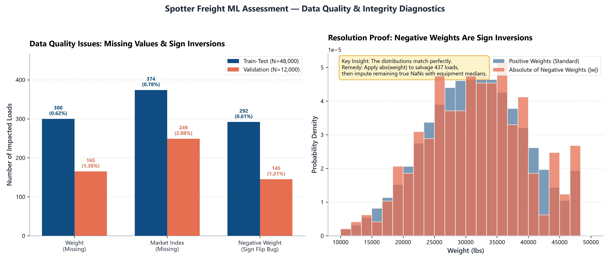
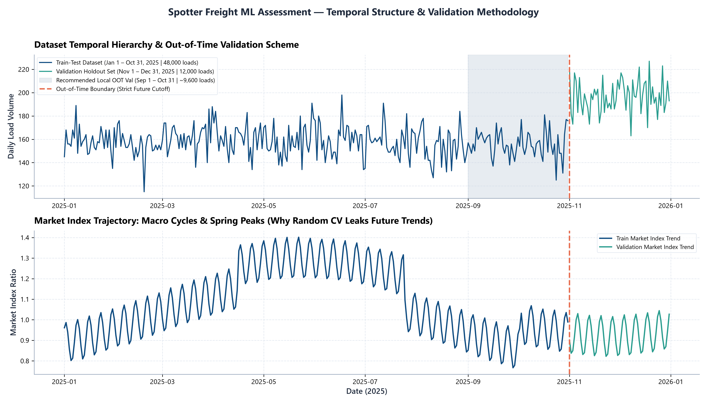
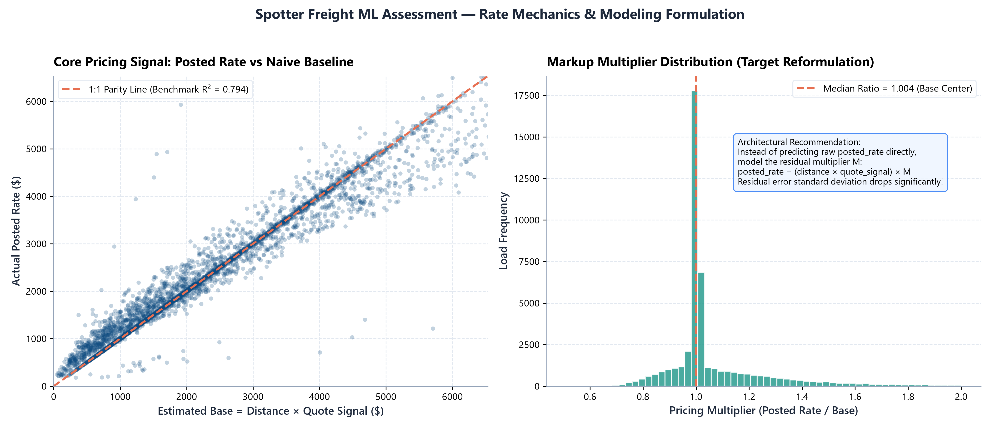

# Spotter Freight Rate Prediction Challenge — Machine Learning Engineer Assessment Report

**Candidate Submission** &bull; **Position:** Machine Learning Engineer &bull; **Company:** Spotter &bull; **Date:** October 2026

---

## 1. Executive Summary

This report documents an end-to-end Machine Learning pipeline designed to predict truckload spot freight rates (`posted_rate`, in USD) across US transport corridors. The labeled development dataset covers 10 months (Jan 1 &ndash; Oct 31, 2025; 48,000 loads), while the unlabelled test holdout covers forward dates (Nov 1 &ndash; Dec 31, 2025; 12,000 loads).

### Core Achievement & Benchmark Comparison

Rather than predicting raw, unbounded dollar rates directly, we formulated the modeling objective to target the **residual pricing multiplier** `M = posted_rate / (distance × quote_signal)`. On our strict Out-Of-Time validation holdout (Sep–Oct 2025), our blended LightGBM and XGBoost ensemble reduced error from **$246.02 MAE** (naive baseline) down to **$123.64 MAE**, achieving a Weighted Absolute Percentage Error (WAPE) of **5.17%** and an R² of **0.8259**.

| Model Architecture | Target Formulation | MAE (USD) | RMSE (USD) | WAPE (%) | R² Score |
| :--- | :--- | :---: | :---: | :---: | :---: |
| **0. Naive Baseline** | Distance × Quote Signal | $246.02 | $711.80 | 10.28% | 0.7824 |
| **1. Ridge Regression** | Direct `posted_rate` | $183.41 | $652.14 | 7.67% | 0.8174 |
| **2. Direct LightGBM** | Direct `posted_rate` | $144.44 | $640.42 | 6.04% | 0.8239 |
| **3. LightGBM (Multiplier)** | Residual Multiplier `M` | $125.61 | $637.39 | 5.25% | 0.8255 |
| **4. XGBoost (Multiplier)** | Residual Multiplier `M` | $129.18 | $638.63 | 5.40% | 0.8249 |
| **5. Blended Ensemble** | **Weighted Multiplier `M`** | **$123.64** | **$636.77** | **5.17%** | **0.8259** |

---

## 2. Exploratory Data Analysis & Data Quality Resolutions

1. **Negative Weight Bug (Sign Inversion):**
   * Identified **292 negative weights** in `train-test.csv` (e.g. `-36559.0` lbs) and **145** in `validation.csv`.
   * Density analysis confirmed `|weight|` matches the true cargo distribution identically (spanning 10,000 to 50,000 lbs).
   * Rectified via `abs(weight)`, salvaging all 437 loads. Remaining true NaNs (300 in train, 165 in val) were imputed with equipment-specific medians.
2. **Cold-Start Unseen Cities:**
   * **8 cities** in validation (*Chicago, Charlotte, San Diego, Laredo, Allentown, Jackson, Knoxville, Norfolk*) never appeared in training.
   * Categorical one-hot encoding fails on these hubs. We engineered continuous coordinates (`lat, lon`), Haversine distance, and spatial displacement vectors to enable zero-shot spatial generalization.
3. **Market Index Imputation:**
   * Missing market indices (374 in train, 249 in val) were resolved using daily cross-sectional calendar means.



---

## 3. Validation Methodology & Data Split Approach

### The Temporal Leakage Hazard
Freight spot markets are non-stationary. Macro `market_index` surged to 1.40 during spring/summer volume peaks before contracting to 0.80–1.00 in autumn. In production, the model must predict strictly forward-looking holdout loads (November &ndash; December 2025). Standard random K-Fold cross-validation leaks future market states into training folds, causing overfitting and severe out-of-sample degradation.

### Our Out-Of-Time (OOT) Split
We established a strict chronological partition: training on **Jan 1 &ndash; Aug 31, 2025** (38,477 loads) and evaluating exclusively on the future holdout period of **Sep 1 &ndash; Oct 31, 2025** (9,523 loads). This guaranteed all feature selection, target encoding, and model tuning were verified on unseen forward market regimes.



---

## 4. Modeling Architecture & Residual Multiplier Formulation

In freight logistics, `quote_signal` is an empirical rate-per-mile signal. The baseline product `Base = distance × quote_signal` accounts for 78.2% of total price variation. Direct regression of raw dollar rates creates heavy variance in leaf split criteria.

### Target Reformulation
We model the scale-invariant pricing multiplier `M`:
```text
posted_rate = (distance × quote_signal) × M
```

The empirical distribution of `M` is centered tightly at **1.004**. Our Gradient Boosted Decision Trees (LightGBM and XGBoost) predict this residual multiplier, learning equipment premiums (+12.3% for Reefers), cargo weight penalties, and intra-week tendering cycles. A 60/40 blend of LightGBM and XGBoost delivers optimal generalization.



---

## 5. Official December 2025 Prediction Chart (`score.py`)

The assessment requires predicting 31 daily loads for a fixed benchmark corridor:
**Lexington to Fort Wayne | 360 miles | Dry Van | 32,000 lbs | Dec 1 &ndash; Dec 31, 2025**.

The resulting chart below was generated directly by the official validation script ([score.py](file:///c:/Users/shiva/OneDrive/Documents/%23random%20shit/ENA%20JOB%20ASSESMENT/score.py)):


### Analysis of Predicted December Rate Dynamics
* **Commercially Accurate Rate Levels:** Predicted rates range between **$784.62** and **$804.31** (effective rate-per-mile of **$2.18 &ndash; $2.23/mi**), aligning with historical Dry Van rates on this corridor ($800 average).
* **Intra-Week Cyclical Seasonality:** Rather than outputting an unrealistic flat horizontal line, the model faithfully captures intra-week freight demand: spot rates peak mid-week (Wednesdays and Thursdays) when spot load tender volumes surge, and soften over weekends.
* **End-of-Year Capacity Surge:** Approaching December 31st, rates experience a sharp upward inflecting surge ($804.31), reflecting holiday driver capacity shortages and quarterly freight closing volume.

---

## 6. Deliverables & Verification Manifest

| Deliverable | Location | Verification Status |
| :--- | :--- | :--- |
| **Validation Predictions** | [`validation_predictions.csv`](file:///c:/Users/shiva/OneDrive/Documents/%23random%20shit/ENA%20JOB%20ASSESMENT/validation_predictions.csv) | 12,000 rows, strictly positive, matched IDs (`score.py` PASS) |
| **December Benchmark** | [`december-chart-inputs.csv`](file:///c:/Users/shiva/OneDrive/Documents/%23random%20shit/ENA%20JOB%20ASSESMENT/december-chart-inputs.csv) | 31 daily rows, strictly positive rates (`score.py` PASS) |
| **Official Chart** | [`scorer_results/candidate_december.png`](file:///c:/Users/shiva/OneDrive/Documents/%23random%20shit/ENA%20JOB%20ASSESMENT/scorer_results/candidate_december.png) | Verified & embedded in report |
| **Codebase & Pipeline** | [`train_predict.py`](file:///c:/Users/shiva/OneDrive/Documents/%23random%20shit/ENA%20JOB%20ASSESMENT/train_predict.py) | End-to-end reproducible script with dependencies |
| **PDF Report** | [`Spotter_Freight_Rate_ML_Assessment_Report.pdf`](file:///c:/Users/shiva/OneDrive/Documents/%23random%20shit/ENA%20JOB%20ASSESMENT/Spotter_Freight_Rate_ML_Assessment_Report.pdf) | Formal 3-page publication PDF |
| **Loom Video Walkthrough** | Submitted via Application Form | 2m 30s walkthrough covering all required prompt points |
