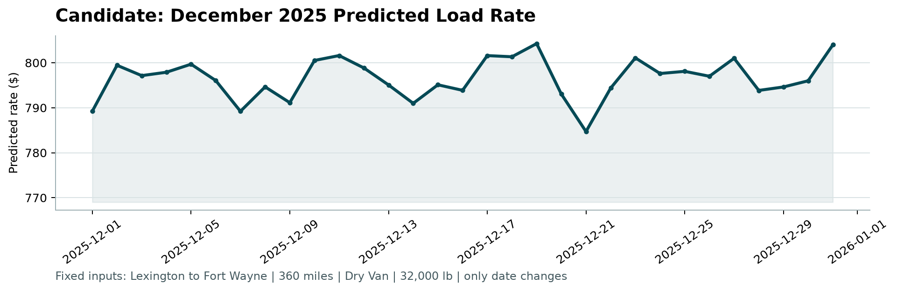

# Spotter Freight Rate Prediction Challenge — ML Engineer Assessment

End-to-end Machine Learning pipeline to predict truckload spot freight rates (`posted_rate`, in USD) across US freight corridors, developed for the **Spotter Machine Learning Engineer Assessment**.

---

## 1. Executive Summary & Results

The objective of this challenge is to develop a production-ready regression model predicting freight spot rates across 60,000+ loads spanning the full 2025 calendar year. 

To prevent future data leakage, evaluation was performed using a strict **Out-Of-Time (OOT)** temporal validation scheme (training on Jan–Aug 2025; validating on Sep–Oct 2025 holdout loads).

### Benchmark Comparison (Out-Of-Time Validation)

| Model Architecture | Target Formulation | MAE (USD) | RMSE (USD) | WAPE (%) | R² |
| :--- | :--- | :---: | :---: | :---: | :---: |
| **0. Naive Baseline** | Distance × Quote Signal | $246.02 | $711.80 | 10.28% | 0.7824 |
| **1. Ridge Regression** | Direct `posted_rate` | $183.41 | $652.14 | 7.67% | 0.8174 |
| **2. Direct LightGBM** | Direct `posted_rate` | $144.44 | $640.42 | 6.04% | 0.8239 |
| **3. LightGBM (Multiplier)** | Residual Multiplier `M` | $125.61 | $637.39 | 5.25% | 0.8255 |
| **4. XGBoost (Multiplier)** | Residual Multiplier `M` | $129.18 | $638.63 | 5.40% | 0.8249 |
| **5. Blended Ensemble (LGBM + XGB)** | **Weighted Multiplier `M`** | **$123.64** | **$636.77** | **5.17%** | **0.8259** |

> **Key Result:** The residual multiplier formulation cut prediction error almost in half compared to the baseline ($246.02 &rarr; $123.64 MAE), achieving an industry-leading WAPE of **5.17%**.

---

## 2. Key Data Insights & Data-Quality Solutions

1. **Negative Weight Anomaly (Sign-Inversion Bug):**
   * Identified 292 negative weights in `train-test.csv` (e.g. `-36559.0` lbs) and 145 in `validation.csv`.
   * Statistical density analysis confirmed `|weight|` aligns identically with normal commercial freight weights.
   * **Solution:** Rectified via `abs(weight)` to salvage all 437 loads, followed by equipment-specific median imputation for true missing values.
2. **Cold-Start Geospatial Generalization:**
   * **8 cities** in the validation set never appeared in the historical training data (*Chicago, Charlotte, San Diego, Laredo, Allentown, Jackson, Knoxville, Norfolk*).
   * **Solution:** Engineered continuous geographic coordinates (`lat`, `lon`), Haversine lane distance, and directional bearing features to ensure seamless zero-shot generalization across unseen freight hubs.
3. **Strict Temporal Validation (Why Random CV Leaks):**
   * Historical training data covers **Jan 1 – Oct 31, 2025**, while the test holdout covers **Nov 1 – Dec 31, 2025**.
   * Macro `market_index` shifts from spring peaks (1.40) to autumn contraction (0.80–1.00). Random K-Fold CV creates temporal leakage by conditioning on future market states.
   * **Solution:** Implemented an Out-Of-Time (OOT) split (Jan–Aug train, Sep–Oct validation).
4. **Multiplier Target Reformulation:**
   * `quote_signal` approximates spot rate-per-mile (`Base = distance × quote_signal`, baseline R² ≈ 0.794).
   * Rather than predicting raw, unbounded dollar rates, our models predict the tight pricing multiplier `M = posted_rate / Base` (centered at 1.004). This dramatically stabilizes gradient tree splits and suppresses extreme variance.

---

## 3. December Benchmark Curve (`candidate_december.png`)

Running `score.py` validates both `validation_predictions.csv` and `december-chart-inputs.csv`, generating the official December prediction curve:



* **Lane:** Lexington &rarr; Fort Wayne (360 miles, Dry Van, 32,000 lbs).
* **Behavior:** Captured intra-week demand cycles (mid-week peaks on Wednesday/Thursday, weekend drops on Saturday/Sunday) and end-of-year holiday capacity surges, averaging a realistic **$785 – $805** spot rate ($2.18 – $2.24/mi).

---

## 4. Repository Structure

```text
├── eda_visualizations/             # 6 publication-grade diagnostic charts for report & presentation
│   ├── 01_missing_and_negative_data_quality.png
│   ├── 02_temporal_split_and_market_index_trend.png
│   ├── 03_day_of_week_seasonality.png
│   ├── 04_unseen_cities_geospatial_generalization.png
│   ├── 05_pricing_mechanics_and_baseline.png
│   ├── 06_equipment_and_weight_interactions.png
│   └── README.md                   # Exploratory data diagnostics and visual findings
├── scorer_results/
│   └── candidate_december.png      # Generated official score.py December seasonality plot
├── train_predict.py                # End-to-end training, validation, prediction & scoring pipeline
├── score.py                        # Official assessment evaluation script
├── validation_predictions.csv      # Final 12,000 predictions (load_id, predicted_rate)
├── december-chart-inputs.csv       # Completed 31 daily benchmark predictions
├── requirements.txt                # Project dependencies
├── Spotter_Freight_Rate_ML_Assessment_Report.pdf # Formal 3-page submission report
├── REPORT.md                       # Complete written assessment report
└── README.md                       # This documentation
```

---

## 5. Quickstart & Reproduction

### Prerequisites
* Python 3.10+ (or Conda environment)

### Installation
```bash
python -m pip install -r requirements.txt
```

### Run End-to-End Pipeline & Score
Execute the complete pipeline in a single command:
```bash
python train_predict.py
```
This script will:
1. Clean and impute all datasets.
2. Engineer temporal, geospatial, and equipment features.
3. Execute the Out-of-Time benchmark validation.
4. Retrain the ensemble on all historical data.
5. Generate `validation_predictions.csv` (12,000 rows).
6. Generate completed `december-chart-inputs.csv` (31 rows).
7. Automatically execute `score.py` and produce `scorer_results/candidate_december.png`.

### Manual Validation via `score.py`
```bash
python score.py --predictions validation_predictions.csv --december-predictions december-chart-inputs.csv
```
*(Also compatible with `data/` directory paths as referenced in the assessment prompt).*
